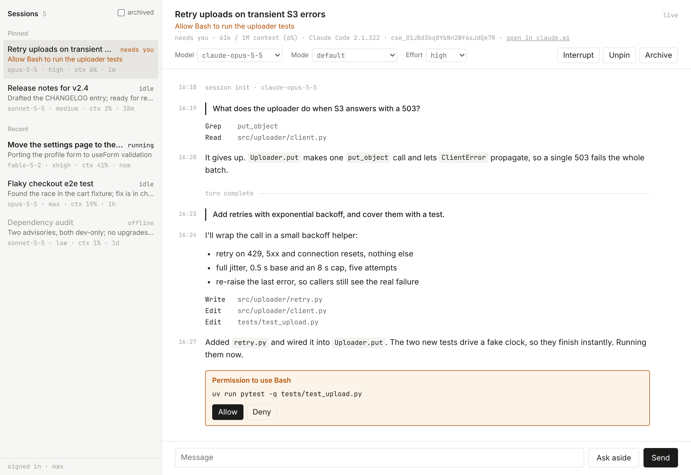

# claude-rc-api

Unofficial Python client for Claude Code Remote Control, reverse-engineered from
the Claude Code CLI and exercised against the live API.

It comes as a [library](#library), a [CLI](#cli) and a [web UI](#web-ui). The
protocol is written up in [`API_REFERENCE.md`](./API_REFERENCE.md).

> [!WARNING]
> Unofficial and unsupported. The endpoints are private (`api.anthropic.com`),
> reconstructed from the CLI binary, and can change or break at any time. Use
> your own account, at your own risk.

> [!NOTE]
> A notable portion of this project is AI-generated. While the relevant code has been appropriately reviewed and tested, you should still operate at your own discretion.

## Install

```bash
pip install "claude-rc-api[cli] @ git+https://github.com/ThatCrispyToast/claude-rc-api"
```

The `cli` extra adds [rich](https://github.com/Textualize/rich) for a prettier
terminal; the library alone needs only [httpx](https://www.python-httpx.org).
With [uv](https://docs.astral.sh/uv/), `uv add` the same requirement, or run the
CLI without installing it:

```bash
uvx --from "claude-rc-api[cli] @ git+https://github.com/ThatCrispyToast/claude-rc-api" claude-rc list
```

## Getting started

1. Log in to Claude Code with a claude.ai account (Pro, Max, Team or
   Enterprise): run `claude`, then `/login`. API-key logins can't use Remote
   Control.
2. Start a session to drive: run `claude remote-control` (or
   `claude --remote-control`) in any project.
3. Check that the client sees it: `claude-rc list`.

The client finds that login on its own. [Credentials](#credentials) covers
where it looks and how to override it.

## CLI

```bash
claude-rc whoami                 # login, org and token status
claude-rc list                   # active sessions (--all adds archived, --pinned filters)
claude-rc get <id>               # session details, as JSON
claude-rc events <id>            # recent history
claude-rc watch <id>             # stream live, read-only
claude-rc info <id>              # summary, context, plan usage, git changes
claude-rc ask <id> "question"    # side question
claude-rc send <id> "message"    # send a message, print the reply
claude-rc repl <id>              # interactive chat
claude-rc rename <id> "title"    # retitle
claude-rc pin <id>               # pin in claude.ai/code's sidebar (unpin undoes it)
claude-rc web                    # browser control panel for all sessions
```

`<id>` is a session's `cse_…` id, as `list` prints it. `ask` is claude.ai's
"btw": the worker answers from its conversation without interrupting a running
turn or adding to the transcript (it costs a model call).

## Web UI

<picture>
  <source media="(prefers-color-scheme: dark)" srcset="docs/webui-dark.png">
  
</picture>

A dependency-free browser control panel for your Remote Control sessions:

- **Sessions**: pins first, each with its effort, context use and status
  summary. Tick *archived* to include those.
- **Conversation**: watch the live event stream, send messages, ask side
  questions, allow or deny tool permissions.
- **Steering**: interrupt, model, permission mode, effort, pin, archive and
  unarchive.

```bash
claude-rc web                          # serves http://127.0.0.1:8765 and opens it
claude-rc web --port 9000 --no-open
```

It's a standard-library `http.server` (no new dependencies) that proxies the
`RemoteControlClient`. It speaks to the private API with *your* OAuth token and
does no auth of its own, so it binds to `127.0.0.1` by default. Pass
`--host 0.0.0.0` only if you accept that anyone who can reach it can steer your
sessions. You can also run it programmatically:

```python
from claude_rc import serve_webui

serve_webui(host="127.0.0.1", port=8765, open_browser=True)
```

## Library

```python
from claude_rc import RemoteControlClient

rc = RemoteControlClient()    # reads ~/.claude, refreshes the token as needed
sid = rc.sessions(statuses="active")[0]["id"]
```

Runnable scripts are in [`examples/`](./examples).

### Sessions

```python
# a page is the 20 newest, archived included, unless filtered
for s in rc.sessions(statuses="active"):
    meta = s.get("external_metadata") or {}
    print(s["id"], s["worker_status"], s["title"], meta.get("effort_level"))

rc.rename_session(sid, "release prep")
rc.pin_session(sid)             # claude.ai/code's Pinned group; unpin_session undoes it
rc.sessions(tags=PINNED_TAG)    # the pins (from claude_rc import PINNED_TAG)
rc.archive_session(sid)         # unarchive_session undoes it

# follow the session list instead of polling it
page = rc.list_sessions(statuses="active")
for kind, s in rc.watch_sessions(resume_token=page["resume_token"]):
    print(kind, s["id"], s["worker_status"], s["title"])    # kind: added | changed
```

The session object already carries the cheap answers, no round trip needed:
`external_metadata` has `effort_level`, `context_usage` (`used_tokens` /
`max_tokens`), `post_turn_summary` (a one-line `status_detail`, plus
`needs_action` when it waits on you) and the worker's `container_cc_version`,
and `tags` holds `ui:pinned` for a pinned session.

### Messages

```python
# ask and wait for the answer: sends, streams from the pre-send cursor,
# and returns the turn's events once it ends
events = rc.send_and_collect(sid, "summarize the current diff", print_stream=True)

# observe read-only
for ev in rc.stream_events(sid):
    if ev.role == "assistant":
        print(ev.text())
    if ev.type == "result":
        break

# withdraw a message before the worker starts on it
import uuid
mid = str(uuid.uuid4())
rc.send_message(sid, "actually, run the linter too", message_uuid=mid)
rc.cancel_queued_message(sid, mid)    # True while it was still queued
```

Relaying a stream? `stream_events(sid, keepalives=True)` also yields the
server's heartbeat (every ~15 s) as a `keepalive` event: write your own, and
stop when your reader has gone.

### Prompts

```python
# answer the worker's prompts
for ev in rc.stream_events(sid):
    if ev.is_blocking_control and ev.control_subtype == "can_use_tool":
        req = ev.payload["request"]
        rc.respond_permission(sid, ev.request_id, allow=True,
                              tool_input=req["input"], tool_use_id=req.get("tool_use_id"))
        break
    if ev.settles_prompt:    # someone else answered it, or the worker withdrew it
        break
```

### Steering

```python
rc.interrupt(sid)
rc.set_model(sid, "claude-opus-5-5")
rc.set_permission_mode(sid, "acceptEdits")
rc.set_effort(sid, "high", wait=6.0)    # low|medium|high|xhigh|max, or None = auto
```

### Worker queries

Each of these waits for the worker's verdict, and raises `ControlRejected` or
`ControlTimeout` when it doesn't get a good one.

```python
# "btw": no interruption, not in the transcript
rc.side_question(sid, "what are you stuck on?")

rc.get_context_usage(sid)         # {totalTokens, maxTokens, percentage, categories…}
rc.get_usage(sid)                 # plan limits: rate_limits.limits[{kind, percent, resets_at}]
rc.get_workspace_diff(sid)        # {stats: {filesCount, linesAdded, linesRemoved}, …} | None
rc.stop_task(sid, "b5rkopq8x")    # task_id from a system/task_started event

# any other control subtype (see API_REFERENCE.md §3.2)
rc.request_control(sid, "mcp_status")
```

### Managed Agents

`ManagedAgentsClient` covers the sibling public Sessions API (`/v1/sessions`,
`x-api-key`), which runs agents in Anthropic's cloud instead of on your machine.

```python
from claude_rc import ManagedAgentsClient

ma = ManagedAgentsClient(api_key="sk-ant-...")
agent = ma.create_agent(
    name="A", model="claude-opus-5-5", tools=[{"type": "agent_toolset_20260401"}]
)
env = ma.create_environment(
    name="e", config={"type": "cloud", "networking": {"type": "unrestricted"}}
)
sess = ma.create_session(agent=agent["id"], environment_id=env["id"])

ma.send_message(sess["id"], "hello")
for ev in ma.stream_events(sess["id"]):
    if ev.type == "agent.message":
        print(ev.text())
    if ev.type == "session.status_idle":
        break
```

## Events

`Event` normalizes both wire formats. For Remote Control the important payload
types are `user`, `assistant`, `result` (turn complete), `control_request` /
`control_response` (steering, prompts, and their answers), and `system` (`init`,
`status`, task events).

| Helper | Meaning |
| --- | --- |
| `ev.type` | Payload type |
| `ev.role` | `"user"`, `"assistant"` or `None` |
| `ev.text()` | Concatenated text blocks (handles str or block-list content) |
| `ev.tool_uses()` | The `tool_use` content blocks |
| `ev.sequence_num` | Remote Control's ordering and resume cursor (int) |
| `ev.source` | `"client"` (a controller) or `"worker"` (Claude Code) |
| `ev.is_turn_end` | A `result` (Remote Control) or `session.status_idle` (Managed Agents) |
| `ev.is_blocking_control` | A worker prompt waiting on you (never a controller's own request) |
| `ev.settles_prompt` | That prompt is over: a controller answered it, or the worker withdrew it |
| `ev.request_id` | The id a `control_request` carries, a `control_response` answers, or a cancel withdraws |
| `ev.worker_state` | `{model, effort, permission_mode, claude_code_version}`, from a `system` `init` or `status` event |
| `ev.attestation` | `"UNSPECIFIED"`, `"VERIFIED"`, `"ABSENT"`… (Trusted Devices) |

## How it works

Remote Control relays, it doesn't run cloud compute. Your local
`claude remote-control` process runs Claude and holds an outbound connection to
Anthropic; the web app and mobile app act as a controller that posts messages
and reads the session's event stream. This library plays that controller role.

```
your script ──► POST /v1/code/sessions/{id}/events           send a message
            ◄── GET  /v1/code/sessions/{id}/events/stream    read the reply (SSE)
```

Each request carries the claude.ai OAuth Bearer token and an
`x-organization-uuid` header.

## Credentials

The client finds your login the way the CLI does, and an environment variable
overrides each part of it:

| | Read from | Override |
| --- | --- | --- |
| OAuth token | `~/.claude/.credentials.json`; on macOS, the login Keychain item `Claude Code-credentials` first | `CLAUDE_RC_ACCESS_TOKEN` or `CLAUDE_CODE_OAUTH_TOKEN` |
| Organization | `organizationUuid` in `~/.claude.json` | `CLAUDE_RC_ORG_UUID` |
| Trusted Devices token | `trustedDeviceToken`, next to the login that enrolled | `CLAUDE_TRUSTED_DEVICE_TOKEN` (the CLI's own) |

**Token refresh** writes the new tokens back where they came from (the
credentials file or the macOS Keychain item) the way the CLI's own refresh
does: only over the login it refreshed, keeping the rest of the document.
Neither that nor an enrollment takes the CLI's lock files, so a write racing one
of the CLI's can lose one side. `persist_refresh=False` keeps refreshes in
memory and turns lazy enrollment off, but the refresh token a refresh spends is
the CLI's too, so the CLI must sign in again.

**Trusted Devices.** Orgs that require them refuse an unenrolled machine with a
403 `untrusted_device`. The client then enrolls it as the CLI does
(`enroll_trusted_device`, which emails the account owner), saves the token, and
retries, with the CLI's guards against enrolling in a loop. Workers can still
drop controller events that carry no device signature; this library doesn't
sign. `ev.attestation` shows what the server recorded, and
[API_REFERENCE.md §3.4](./API_REFERENCE.md#34-device-attestation-trusted-devices)
has the details.

## Safety

- **Reading changes nothing.** `list`, `get`, `events`, `watch` and the
  `RemoteControlClient` read methods (`watch_sessions` included) are read-only.
- **Steering injects into a live session**, so only use `send`, `repl`,
  `send_message`, `interrupt` and the other steering calls on sessions you own.
  `rename`, `pin` and `archive` change what every controller's list shows.
- **Worker queries leave a trace.** `ask`, `info`, `side_question` and `get_*`
  leave a `control_request` / `control_response` pair in the event log, as
  claude.ai's own attach does. A side question also costs a model call.
- **Your login can change on disk.** A token refresh rewrites the stored login,
  and a Trusted Devices enrollment emails the account owner; see
  [Credentials](#credentials).
- This project never prints or transmits your tokens.

## Development

```bash
uv sync --extra cli --extra test    # runtime, pretty CLI and pytest
uv run --extra test pytest -q       # offline: no network, no credentials
```

```
claude_rc/
  credentials.py   # OAuth load + refresh (file or macOS Keychain), org uuid
  client.py        # RemoteControlClient (mode A) + ManagedAgentsClient (mode B)
  events.py        # Event model + builders for both wire formats
  sse.py           # dependency-free SSE parser
  cli.py           # `claude-rc` command line
  webui.py         # `claude-rc web`, the stdlib http.server control panel
  static/          # the web UI single-page app
API_REFERENCE.md   # full reverse-engineered protocol reference
docs/              # web UI screenshots, from made-up sessions by screenshot.py
examples/          # runnable examples
tests/             # offline unit tests (pytest)
```

### Used by

[`claude-remote-bridge`](https://github.com/ThatCrispyToast/g2-claude-remote)
(the `server/` half of the Claude Remote glasses app) depends on this package
straight from git and wraps `RemoteControlClient` in a JSON + SSE HTTP bridge.
It imports `client`, `credentials`, and `events` (prompt answers, side
questions, the session metadata) and resolves this repo's default branch on each
fresh `uv` install, so keep those three backwards-compatible.
